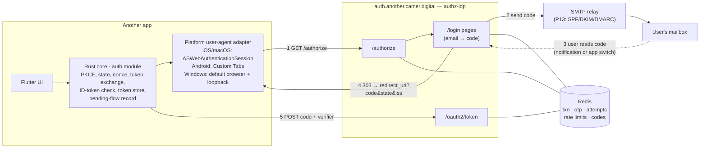

# P6 — email-code login through the system browser

**Spike question (Sprint backlog, P6):** can `authz-idp` sign a user in with an emailed one-time
code, through the system browser, on iOS 15/16, Android 8/9, Windows 10 and macOS 12, on
`auth.another.camer.digital`?
**Done when:** a video per OS and a list of blockers. **Feeds:** ADR 15. **Box:** 3 days.
**Pair:** Intermediate 1 (owns `APP-CORE`'s `auth` module from S1) + Senior 1 (owns `AUTHZ-IDP`).

This document is the design the prototype implements and the hypotheses the videos must confirm
or kill. The spike report (question, setup, evidence, answer, recommendation, follow-ups) is
written from it on Oct 23.

---

## 1. Constraints we inherit

| Source | Constraint |
|---|---|
| RFC 8252 (OAuth for native apps) | External user agent only, never an embedded WebView. Public client, PKCE. Desktop: loopback IP redirect, any port. Mobile: private-use URI scheme or claimed HTTPS. |
| `lightbridge-authz` `docs/rfc-8252-loopback-redirects.md` | `authz-idp` admits a loopback redirect only on `127.0.0.1`/`[::1]` (never `localhost`), for a public client, matching a registered URI in everything but the port. `S256` is mandatory. |
| ADR-0021 / ADR-0020 | A browser login leaves a revocable session cookie (`__Host-authz_session`) bound to the `sessions` table. |
| ADR-0024 (correction) / ADR-0025 | We own our subjects; an accountless login is **refused** today. Email-code login creates people, so first-login provisioning (#739) must run on this path too. |
| ADR-0029 | The login pages are the `authz-ui` SPA, pinned by digest. |
| Backlog S1 → S3 | S1: code storage + rate limits in Redis. S2: hosted pages (sign-in, email code, SMS code, recovery). S3: email code end to end with PKCE and loopback. |
| Market | Many users on low-RAM Android phones (Tecno, Infinix, itel, Samsung A-series) where the default browser is often not Chrome, and the OS kills background apps aggressively. Mobile data is slow and drops. |

## 2. Shape



**Who owns what.** The Rust core owns every secret and every check: PKCE verifier, `state`,
`nonce`, the token request, ID-token verification, refresh-token storage, and on desktop the
loopback listener itself. The Flutter side only opens a user agent and returns the callback URL.
This keeps one implementation of the protocol across six platforms and means the platform adapter
is the only thing that differs per OS, which is exactly what P6 measures.

## 3. Sequence

```mermaid
sequenceDiagram
  autonumber
  participant C as Rust core
  participant U as User agent (system browser)
  participant I as authz-idp
  participant R as Redis
  participant M as Mailbox
  C->>C: verifier, S256 challenge, state, nonce; persist pending flow
  C->>U: open /authorize?…&redirect_uri=<per OS>
  U->>I: GET /authorize
  I->>I: client + redirect rule, S256, scopes
  I->>R: SETEX txn (15 min)
  I-->>U: 303 /login/{txn} + Set-Cookie p6_txn (binds txn to this browser)
  U->>I: POST email
  I->>R: INCR rate limits (per email, per IP)
  I->>R: SETEX otp = HMAC(pepper, txn, code) (10 min)
  I->>M: "123456 is your Another sign-in code"
  I-->>U: 303 /login/{txn}/code
  Note over U,M: user reads the code — from the notification, or by switching apps
  U->>I: POST code
  I->>R: INCR attempts (max 5) · constant-time compare · DEL otp, txn
  I->>R: mint subject on first login; SETEX session; SETEX auth code (60 s)
  I-->>U: 303 redirect_uri?code&state&iss (or "Return to Another" page)
  U->>C: callback URL (loopback hit / scheme intercepted)
  C->>C: check state, iss (RFC 9207)
  C->>I: POST /oauth2/token code + verifier
  I->>R: GETDEL code (single use) · PKCE check
  I-->>C: access, ID, refresh tokens
  C->>C: verify ID token (JWKS, iss, aud, nonce, exp); clear pending flow
```

## 4. The per-OS answer we expect (to be confirmed by video)

| OS | User agent | Redirect URI | Why this one | Alternative filmed |
|---|---|---|---|---|
| **Windows 10** | Default browser (usually Edge) | `http://127.0.0.1:<ephemeral>/callback`, listener in the Rust core | The only RFC 8252 option on Windows without registering a URL scheme in the registry; already supported by `authz-idp`'s loopback rule | — |
| **macOS 12** | `ASWebAuthenticationSession` (ephemeral) **or** default browser + loopback | `digital.camer.another:/oauth2redirect` / loopback | ASWebAuthenticationSession gives a sheet tied to the app window and no orphan tab; loopback gives one code path with Windows | Both, then pick in ADR 15 |
| **iOS 15/16** | `ASWebAuthenticationSession`, `prefersEphemeralWebBrowserSession = true` | `digital.camer.another:/oauth2redirect` | HTTPS callbacks in ASWebAuthenticationSession need iOS 17.4. Ephemeral also removes the "wants to use … to Sign In" alert | Non-ephemeral (alert shown); claimed HTTPS (expected to fail) |
| **Android 8/9** | Custom Tabs (falls back to the default browser if no provider) | `digital.camer.another:/oauth2redirect` | App Link verification is unreliable on old Android and on non-Chrome default browsers; a private-use scheme only needs an intent filter | 303 vs "Return to Another" page; claimed HTTPS |

The private-use scheme is reverse-DNS of a domain we own (`digital.camer.another`), as RFC 8252
§7.1 requires. PKCE is what makes a scheme hijack harmless: another app catching the redirect gets
a code it cannot redeem.

## 5. Server-side design (feeds `AUTHZ-IDP` in S1)

| Key | Value | TTL | Notes |
|---|---|---|---|
| `txn:{id}` | pending authorization request | 15 min | id is 144-bit random; bound to the browser by an `HttpOnly; SameSite=Lax` cookie scoped to `/login` |
| `otp:{txn}` | `{email, HMAC(pepper, txn ‖ code), sent_at}` | 10 min | never the code itself; bound to the txn, so a code works only in the browser that asked for it |
| `otp-attempts:{txn}` | counter | 10 min | 5 wrong codes delete the OTP |
| `rl:email:{HMAC(email)}` | counter | 15 min | 5 sends; email hashed so Redis never holds plaintext addresses in key names |
| `rl:ip:{ip}` | counter | 1 h | 30 sends; behind the gateway this needs the real client IP (trusted `X-Forwarded-For`) |
| `code:{code}` | auth code record | 60 s | `GETDEL` makes redemption single-use under races |
| `session:{id}` | browser SSO session | 12 h | in `authz-idp` this is the ADR-0020 `sessions` row, not Redis |

Choices worth carrying into the real service:

- **The code is in the email subject.** On a phone the user can read it from the notification
  without leaving the browser — the cheapest defence against Android killing the app (H1).
- **Six digits, 10 minutes, 5 attempts per code, 5 sends per 15 min.** 5 guesses at 10⁻⁶ each per
  code; enumeration by resend is capped by the per-email limit.
- **Same response whether the address is known or not.** The page never says "no such user".
- **No `form-action` in the CSP.** Chrome applies `form-action` to the redirect after a form POST,
  and that redirect goes to `127.0.0.1:<port>` or a custom scheme. `'self'` would block the very
  hop being tested. The real `authz-ui` CSP must list the redirect targets or omit the directive.
- **`iss` on the authorization response (RFC 9207)** so the app can reject a mix-up.
- **The pages work without JavaScript.** The prototype uses server-rendered forms on purpose, to
  separate browser behaviour from SPA behaviour. If a device fails here, the SPA will fail too; if
  it passes here, run it once more against the `authz-ui` SPA before calling it green.

## 6. Hypotheses = candidate blockers

Each has a test in `docs/test-protocol.md`. The report keeps the ones that turn out to be real.

| # | Hypothesis | Where | If true |
|---|---|---|---|
| H1 | The OS kills the app while the user is in the mail app. The callback then arrives at a cold start, and the in-memory PKCE verifier is gone | Android 8/9, low-RAM phones | Persist the pending flow (verifier, state, nonce) in the core store. Handle the redirect intent at cold start. The code in the subject line reduces app switches |
| H2 | No Custom Tabs provider (Transsion/Huawei default browsers), so the flow opens in a full browser. That browser may ask "open with", or ignore the custom-scheme redirect | Android | Force a known provider when installed, show the "Return to Another" interstitial, or fall back to first-party native screens (see H9) |
| H3 | Chrome will not hand a custom-scheme redirect to the app without a user gesture | Android | Use variant B (interstitial with a tap) |
| H4 | Claimed HTTPS callbacks don't complete the session | iOS 15/16 | Use a private-use scheme on iOS < 17.4 (expected) |
| H5 | A non-ephemeral session shows the system "wants to use … to Sign In" alert | iOS, macOS | Use an ephemeral session; we lose browser SSO, which email-code login doesn't need |
| H6 | ASWebAuthenticationSession survives a switch to Mail and back. If it doesn't, the session is cancelled | iOS 15/16 | Hard blocker for iOS; would push toward native screens |
| H7 | Windows: a firewall prompt on bind, the app window not regaining focus, or the default browser not being Chromium | Windows 10 | Bind `127.0.0.1` only (no prompt expected), `window_manager.focus()` on callback, no-JS pages |
| H8 | Safari 15 refuses or warns on HTTPS → `http://127.0.0.1` | macOS 12 | Use ASWebAuthenticationSession on macOS |
| H9 | Any of H1, H2 or H6 is unfixable | Mobile | Plan B: native email and code screens. The core talks to a first-party endpoint (IETF draft "OAuth 2.0 for First-Party Applications", authorization challenge endpoint). That departs from RFC 8252 and needs its own ADR |
| H10 | Code delivery is slow or lands in spam for local providers | All (P13) | Measured by `smtp_ms` and `seconds_since_sent` on `/spike`; P13 owns the fix |
| H11 | Cheap phones have wrong clocks, so strict `iat`/`exp` checks fail | Android | Allow a leeway in the core; never reject on `iat` in the future |

## 7. What goes into ADR 15

1. Per-OS user agent and redirect URI (table §4, as confirmed).
2. `authz-idp` authenticates email codes itself, with no Keycloak on this leg. This needs a decision
   on how it relates to ADR-0019 (Keycloak brokering) and ADR-0024's accountless refusal.
3. Code policy (§5 numbers) and where it lives: Redis for txn, OTP and rate limits; `sessions` for the browser session.
4. The pending-flow persistence requirement on the core (H1).
5. CSP and no-JS requirements for `authz-ui` (§5).
6. Plan B trigger (H9), if any blocker forced it.

## 8. What the prototype does not do

Postgres, Keycloak, the `authz-ui` SPA, `__Host-` cookies over plain HTTP, key persistence (keys
are regenerated on restart), SMS codes, recovery, account provisioning rules, real SMTP
(Mailpit captures everything). It is throwaway and lives in `vymalo/spike-p6-*`.
